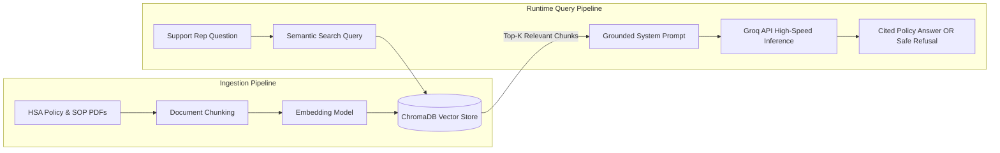

# HSA Policy RAG SOP Assistant

[](YOUR_YOUTUBE_LINK_HERE)


## Overview
A Retrieval-Augmented Generation (RAG) assistant designed to eliminate manual research time for customer support representatives. This tool ingests complex Health Savings Account (HSA) policy PDFs and allows agents to query them via semantic search, returning instant, accurate, policy-grounded answers.

## Business Impact
* **Reduced Average Handling Time (AHT):** Replaces manual `Ctrl+F` document searches across dense policy PDFs with instant semantic retrieval in under 2 seconds.
* **Improved First Call Resolution (FCR):** Ensures reps have immediate access to accurate, context-aware policy guidelines while live on the phone with customers.
* **Compliance & Risk Mitigation:** Grounded system prompting forces the assistant to answer strictly from retrieved SOP chunks and refuse out-of-scope tax or investment speculation.

---

## RAG Pipeline Architecture



## Core Capabilities
* **PDF Ingestion & Chunking:** Processes unstructured standard operating procedure (SOP) documents into overlapping semantic chunks so multi-part eligibility rules stay intact.
* **Semantic Search:** Retrieves highly relevant document chunks from ChromaDB based on user intent rather than brittle keyword matching.
* **Interactive UI:** Provides a clean, chat-like Streamlit interface for agents to ask policy questions and verify source context during live calls.

## Retrieval & Guardrail Behavior

| Query Type | Example Rep Prompt | Assistant Behavior |
|---|---|---|
| **In-Scope SOP Lookup** | *"What are the HSA catch-up contribution rules for account holders aged 55 and older?"* | Retrieves the exact SOP section, states the rule clearly, and cites the policy chunk. |
| **Procedural Exception** | *"How do we process an excess contribution removal before the tax deadline?"* | Returns the step-by-step operational workflow and required form documentation. |
| **Out-of-Scope / Advisory** | *"Which S&P 500 index fund should the customer pick for their HSA investments?"* | **Guardrail Triggered:** Refuses investment/tax advisory speculation and directs the rep to the approved compliance disclosure. |

## Tech Stack
* **Language:** Python 3.10+
* **LLM & Inference:** Groq API (`llama3-70b-8192` high-speed LPU inference)
* **Orchestration:** LangChain
* **Vector Database:** ChromaDB
* **Frontend:** Streamlit
* **Environment Management:** `python-dotenv`

## Known Limitations & Production Roadmap
1. **Semantic vs. Hybrid Search:** Pure vector similarity excels at conceptual policy questions but can underperform on exact IRS form numbers (e.g., `Form 5498-SA` vs. `Form 1099-SA`). A production iteration combines ChromaDB dense embeddings with **BM25 keyword retrieval (Hybrid Search)**.
2. **Automated SOP Versioning:** Policy updates currently require re-running the ingestion pipeline. Production deployment would trigger automated re-indexing via webhook whenever an SOP PDF is updated, filtering chunks by `effective_date` metadata.

---

## Quickstart & Local Setup

```bash
# 1. Clone the repository
git clone [https://github.com/okrao/rag_sop_assistant.git](https://github.com/okrao/rag_sop_assistant.git)
cd rag_sop_assistant

# 2. Create and activate a virtual environment
python3 -m venv venv
source venv/bin/activate

# 3. Install dependencies
pip install -r requirements.txt

# 4. Configure environment variables
cp .env.example .env
# Add your GROQ_API_KEY inside .env

# 5. Launch the Streamlit application
streamlit run app.py
```